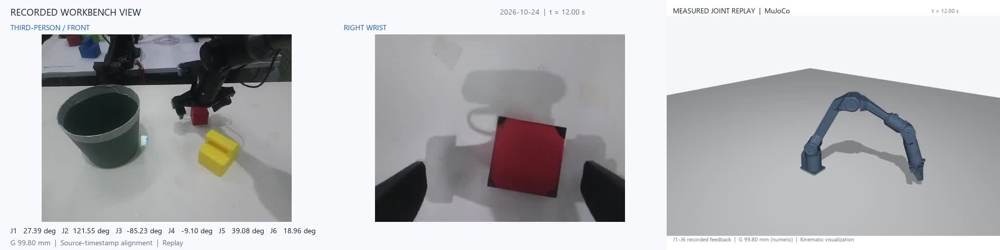

# COBOT MAGIC Workbench

**Yang Taige · Ye Hanzhi — Emerge Robotics**  
HKU Faculty of Engineering · Tam Wing Fam Innovation Wing

[Project page](https://eddy-yang.github.io/cobot-magic-workbench/) · [User manual](https://eddy-yang.github.io/cobot-magic-workbench/manual.html) · [Windows SDK](https://github.com/EDDY-YANG/cobot-magic-workbench/releases/tag/v0.1.0) · [中文手册](docs/USER_GUIDE.zh.md)

A browser workspace linking a Windows operator PC, an RTX 4090 edge host and COBOT MAGIC: device status, teleoperation, recording, policy deployment, controller selection and experiment review.

## Try it

Download and extract `cobot-magic-sdk-windows-x64.zip`, then double-click **Start-Workbench.cmd**. Python and OpenSSH are included. The recorded demo runs offline. For live access, enter your own authorized SSH profile and the configured GPU-host management port. The client does not automatically start a model or move a robot.

## Source map

| Folder | Function |
|---|---|
| `client/` | Portable Windows launcher, private SSH transport and protocol-checked gateway |
| `server/`, `web/` | GPU-host management service and compact management UI |
| `lab_stack/` | Installed operator interface, shared device agent, recording and deployment orchestration |
| `controllers/realtime_v2/` | Verified V2 source snapshot including evidence and trajectory-coverage fixes |
| `controllers/shared_runner/` | FP32/BF16 runner snapshot and trajectory processing |
| `inference/` | FP32 supervisor and BF16 service/integration source |
| `site/` | Bilingual project/manual, actual UI source preview and measured replay |
| `tools/`, `tests/` | Packaging, provenance, page generation and offline checks |

The November 19 async recording/flush change (`3e6bd5e`) is included byte-for-byte in `recording.py` and `recording_lifecycle.py`. The V2 source was matched against all 64 source hashes of release `cdb09c1`; public path substitutions are recorded separately. Snapshot metadata lives in `docs/`.

## Scope

This is a research release, not a complete new-robot installer. The Windows client is portable; device, controller and model services require installation-specific environments, SSH authorization, USB identity and current boot/source binding. No weights or private machine configuration are included. The current policy experiments use the right follower arm; DAgger tools are under development.

The demo uses a real 2026-10-24 recording (FP32, step 10000, Realtime-VLA V2). That run ended on an evidence-queue error. Native camera/state streams were retained; task success was not scored. MuJoCo displays measured J1–J6 kinematics, not contact physics. Gripper width is numerical because the model aperture mapping is not calibrated.

## Develop

See [development and publication](docs/development.md), [source contracts](docs/server-contract.md), and [AGENTS.md](AGENTS.md). Changes are committed and pushed with a reviewable diff. GitHub Pages publication does not activate robot software.

## License

Original code/docs: [MIT](LICENSE). Recorded demo exports: CC BY 4.0. Third-party code/assets retain their licenses; see [notices](THIRD_PARTY_NOTICES.md). The incomplete-license whole-machine v2 asset is linked at source and excluded from distribution.
